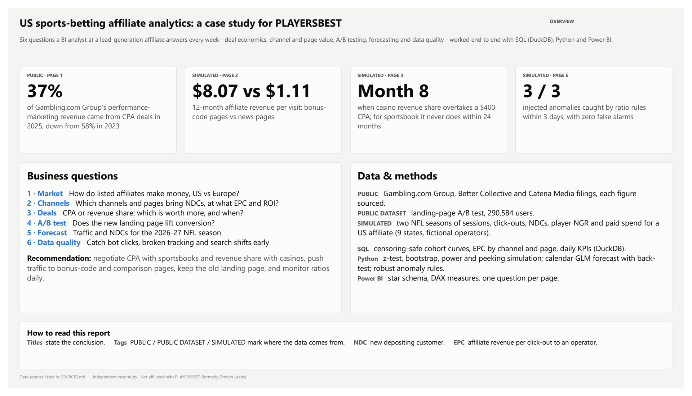
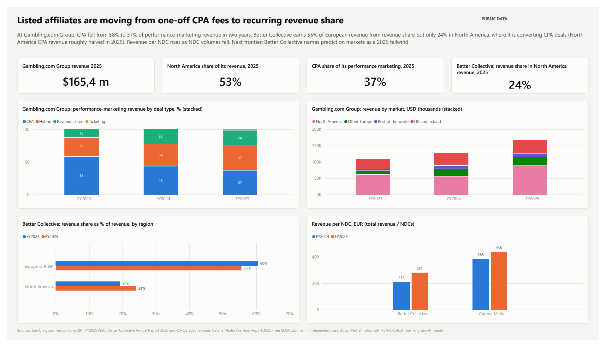
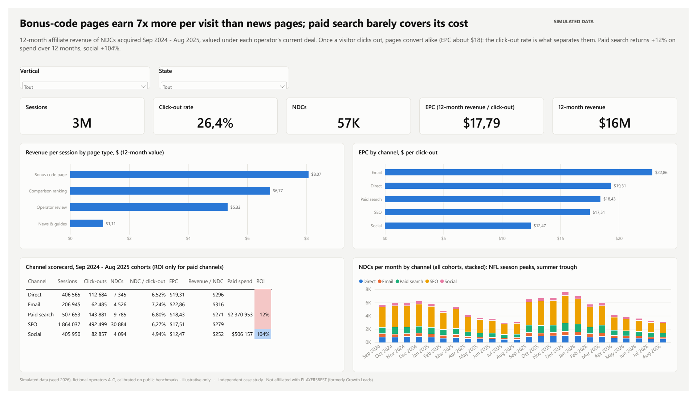
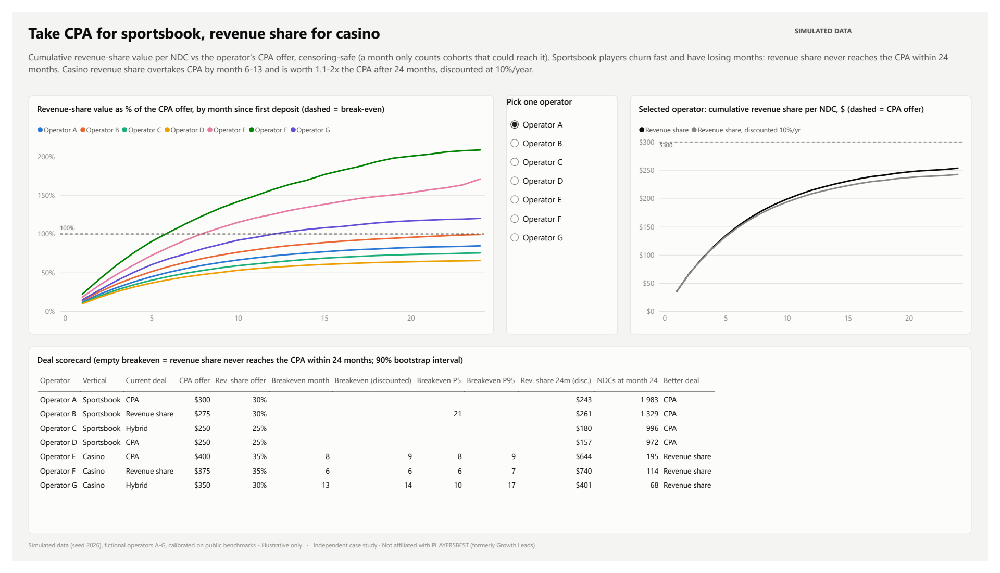
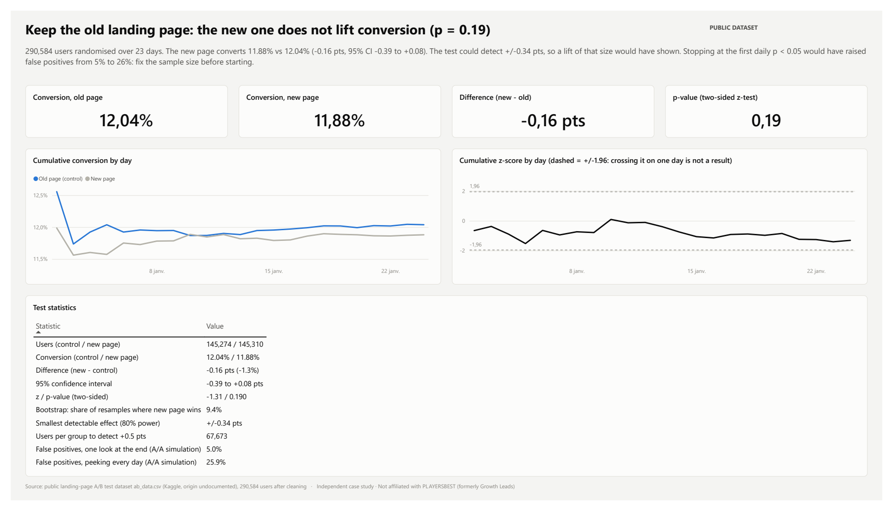
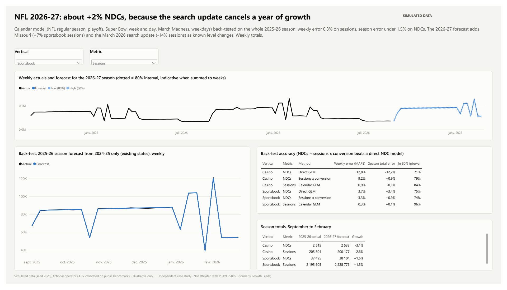
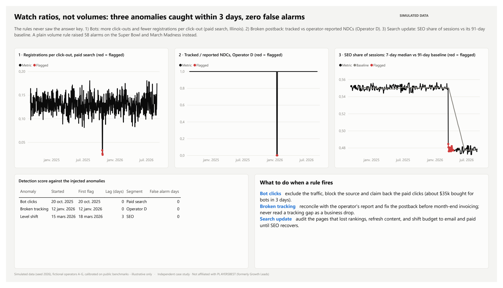

# US sports-betting affiliate analytics - a case study for PLAYERSBEST

Independent analysis built for a *BI Data Analyst* application.
**Not affiliated with PLAYERSBEST (formerly Growth Leads).** Public figures come from listed affiliates' filings; the A/B test uses a public dataset; everything else is **simulated and labelled as such** (fictional operators A-G).

## Questions and answers
| # | Question | Data | Answer |
|---|---|---|---|
| 1 | How do listed affiliates make money, US vs Europe? | Gambling.com Group 20-F, Better Collective and Catena Media reports (public) | Affiliates are moving from one-off CPA fees to recurring revenue share. At Gambling.com Group, CPA fell from 58% (2023) to 37% (2025) of performance-marketing revenue. Better Collective earns 55% of European revenue from revenue share but 24% in North America, where its CPA revenue roughly halved in 2025. |
| 2 | Which channels and content pages bring NDCs, at what EPC? | Simulated (2 NFL seasons, 9 states) | Bonus-code pages earn $8.07 of 12-month revenue per visit vs $1.11 for news pages; after the click, pages convert alike (EPC ~$18). Paid search returns +12% on spend over 12 months, social +104%. |
| 3 | CPA or revenue share: which deal is worth more, and when does revenue share overtake CPA? | Simulated player NGR, 24 months | Sportsbook: take CPA (revenue share never catches up within 24 months). Casino: revenue share overtakes CPA by month 6-13 and is worth 1.1-2x the CPA after 24 months, even discounted at 10%/year. |
| 4 | Does a new landing page lift conversion? | `ab_data.csv`, 290,584 users (public dataset) | No: 11.88% vs 12.04% (-0.16 pts, p = 0.19). The test could detect +/-0.34 pts. Peeking daily would raise false positives from 5% to 26%. |
| 5 | Traffic and NDCs for the 2026-27 NFL season? | Simulated | Calendar model back-tested on a full season (weekly error 0.3% on sessions, season error under 1.5% on NDCs). 2026-27: about +2% NDCs, because a March 2026 search update cancels a year of growth. |
| 6 | Can we catch bot clicks, broken tracking and search shifts early? | Simulated, 3 injected anomalies | Ratio-based rules caught all three within 3 days with zero false alarms; a volume rule raised 58 false alarms on sports events. |

## The report
Seven pages, one question each, conclusion in the title: overview, the affiliate market, channels & pages, CPA vs revenue share, landing-page A/B test, 2026-27 forecast, data quality & anomalies.
Full report: [docs/PlayersBestCaseStudy.pdf](docs/PlayersBestCaseStudy.pdf). To explore it, open `powerbi/PlayersBestCaseStudy.pbix` (data included) in Power BI Desktop; `PlayersBestCaseStudy.pbip` is the same report as readable source files.



| | |
|---|---|
|  |  |
|  |  |
|  |  |

## How it is built
```
data/public      verified figures from listed affiliates (affiliates_public.csv), one source per row
data/simulated   simulated sessions, click-outs, NDCs, player NGR, paid spend, deals, anomaly log
data/raw         ab_data.csv and source PDFs (not committed, see SOURCES.md)
data/output      SQL and notebook outputs read by Power BI
sql/             DuckDB: EPC by channel/page, deal breakeven curves, daily KPIs, A/B cleaning, NDC valuation
notebooks/       analysis.py / analysis.ipynb: one section per question
src/             simulate.py, run_sql.py, build_notebook.py, build_semantic_model.py, build_report_pages.py
powerbi/         Power BI project (.pbip: TMDL semantic model + PBIR report), .pbix, theme
docs/            report PDF and page screenshots
```
- **SQL** is censoring-safe: a cohort only counts for month *n* once every player in it could have reached month *n*; channel and page value use cohorts whose first 12 months are fully observed.
- **Python**: two-proportion z-test, bootstrap, power analysis and an A/A peeking simulation; quasi-Poisson calendar regression with a full-season back-test; NDCs forecast as sessions x conversion; robust (median/MAD) anomaly rules scored against the injected answer key.
- **Power BI**: star schema (Traffic, Operator Daily, NDCs, Marketing Cost + Date, Channel, State, Page Type, Vertical, Operator), about 50 DAX measures, generated from code.

## Reproduce
```bash
python -m venv .venv && .venv/Scripts/pip install -r requirements.txt
# download ab_data.csv (see SOURCES.md) into data/raw/
.venv/Scripts/python src/simulate.py
.venv/Scripts/python src/run_sql.py
.venv/Scripts/python src/build_notebook.py
.venv/Scripts/jupyter nbconvert --to notebook --execute --inplace notebooks/analysis.ipynb
.venv/Scripts/python src/build_semantic_model.py
.venv/Scripts/python src/build_report_pages.py
```
Power BI: open `powerbi/PlayersBestCaseStudy.pbip`, set the `DataFolder` parameter to your `data\` folder if needed, and refresh (or simply open the `.pbix`).

## Limits
- Simulated data demonstrate methods, not PLAYERSBEST's real performance; they follow the model's structure closely, so real forecast errors would be larger.
- Month-24 deal values rest on the earliest cohorts only (68-1,983 NDCs per operator), hence the bootstrap intervals.
- Gambling.com Group's deal mix is a share of performance-marketing revenue; Better Collective's quarterly revenue-share percentages are a share of NDCs. They are not compared directly.
- The A/B dataset's origin is undocumented; it illustrates the method.
- 2026-27 NFL dates are assumed from the published schedule.
